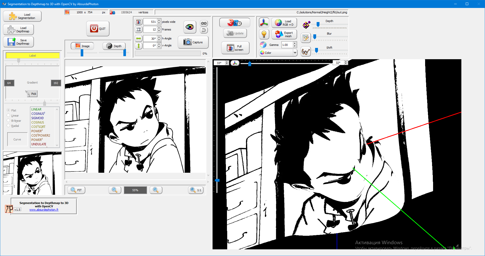

# Normal2Height2

Convert a tangent-space normal map into a grayscale height (displacement) map using numerical optimization.

An accompany to https://github.com/V-Sense/DeepNormals.

Please note also https://github.com/Chaosinism/NormalMapTool.

Can be used together with https://github.com/aliakseis/line-filler and https://github.com/aliakseis/DeepNormals-tflite.

Demo using https://github.com/aliakseis/segmentation-depthmap-3d-opencv:


## Overview

**Normal2Height2** reconstructs a height field from a normal map by solving an inverse gradient problem. Instead of performing direct integration, it formulates height reconstruction as a global least-squares optimization and solves it using the **L-BFGS** (Limited-memory Broyden–Fletcher–Goldfarb–Shanno) algorithm.

The tool is useful for:

* Generating displacement maps from normal maps
* Recovering approximate surface geometry
* Texture and material processing workflows
* Preparing assets for rendering engines that require height maps
* Research and experimentation with normal integration techniques

## How It Works

### 1. Load Normal Map

The application loads an RGB normal map using OpenCV.

For each pixel:

```text
R -> X component
G -> Y component
B -> Z component
```

The normal vector is decoded from the standard 8-bit normal-map representation.

### 2. Convert Normals to Surface Slopes

The normal vector:

```text
N = (nx, ny, nz)
```

is converted into local height gradients:

```text
∂h/∂x = nx / nz
∂h/∂y = ny / nz
```

These gradients describe how the unknown height field should change in both directions.

### 3. Global Optimization

An unknown height value is assigned to every pixel.

The optimizer minimizes the error between:

* gradients implied by the reconstructed height field
* gradients extracted from the normal map

For every interior pixel:

```text
kx = (h(x+1,y) - h(x-1,y)) / 2
ky = (h(x,y+1) - h(x,y-1)) / 2
```

The objective function accumulates:

```text
(kx_target - kx)^2 +
(ky_target - ky)^2
```

across the entire image.

The optimization is solved using:

* L-BFGS
* analytic gradients
* iterative convergence monitoring

### 4. Post-Processing

After optimization:

1. A small Gaussian blur is applied.
2. Extreme low values are clipped using a percentile threshold.
3. The result is normalized into the range:

```text
[0, 1]
```

4. The height map is displayed and optionally saved.

## Features

* Normal map → height map reconstruction
* Global least-squares optimization
* L-BFGS solver
* Analytic gradient computation
* OpenCV-based image processing
* Automatic normalization
* Optional image export
* Interactive result preview

## Dependencies

### OpenCV

Used for:

* Image loading
* Matrix operations
* Gaussian filtering
* Visualization
* Image export

### libLBFGS

Used for numerical optimization of the height field.

Project:

https://github.com/chokkan/liblbfgs

## Building

Example using CMake:

```bash
mkdir build
cd build

cmake ..
cmake --build . --config Release
```

Ensure OpenCV and libLBFGS are installed and discoverable by CMake.

## Usage

```bash
Normal2Height2 input_normal.png
```

Display reconstructed height map:

```bash
Normal2Height2 rock_normal.png
```

Save result:

```bash
Normal2Height2 rock_normal.png rock_height.png
```

## Input Requirements

Expected input:

* Tangent-space normal map
* 8-bit RGB image
* Blue channel representing Z component

Special handling:

```text
RGB(255,255,255)
```

is treated as a flat surface region.

## Algorithm Notes

Unlike simple row-by-row or column-by-column integration methods, this approach performs a global optimization over the entire image.

Advantages:

* Reduced accumulation error
* Better consistency across large surfaces
* More robust handling of noisy normals

Limitations:

* Computationally heavier than direct integration
* Reconstruction is only determined up to an additive constant
* Invalid or near-zero Z components may produce unstable gradients

## Example Pipeline

```text
Normal Map
      ↓
Decode Normals
      ↓
Extract Slopes
      ↓
L-BFGS Optimization
      ↓
Height Field
      ↓
Blur + Normalization
      ↓
Output Height Map
```

## Output

The generated image is a grayscale height map suitable for:

* displacement mapping
* terrain generation
* material authoring
* geometry reconstruction workflows
